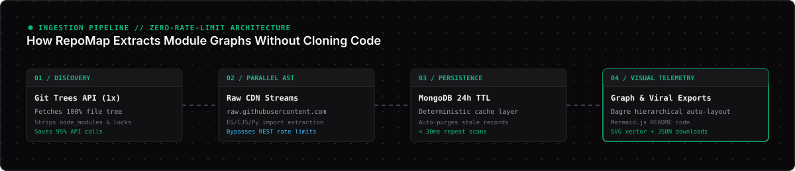
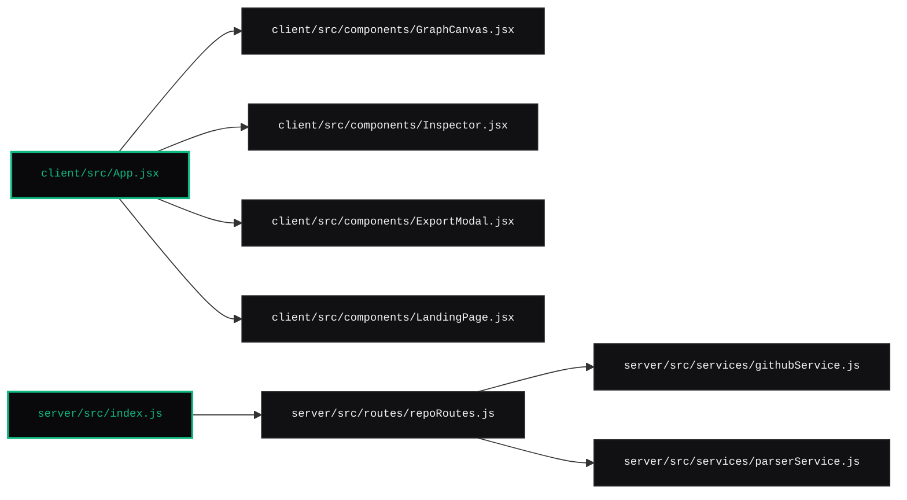

<div align="center">


<br/><br/>

<a href="https://github.com/AtharvDoiphode/Repomap">
  
</a>

<br/>

<p align="center">
  <b>Instant GitHub module dependency visualizer, architecture health audit engine, and native Mermaid.js diagram generator for your project README.</b>
</p>

<p align="center">
  <a href="#key-capabilities">Key Features</a> •
  <a href="#pipeline-architecture">Pipeline Architecture</a> •
  <a href="#sample-mermaid-export">Sample Diagram</a> •
  <a href="#quickstart">Quickstart</a> •
  <a href="#tech-stack">Tech Stack</a>
</p>

<!-- Flat Square Badges -->
<p align="center">
  
  
  
  
  
  
  
  
</p>

</div>

---

## ⚡ The Problem & The Solution

> Traditional GitHub code search and dependency mapping tools make 50+ recursive REST calls, quickly depleting GitHub's 60 req/hr unauthenticated rate limit.

**RepoMap** re-engineers this pipeline from the ground up:
1. **Single-Call Recursive Tree Fetch:** Pulls the entire repository index in a single `GET /repos/{owner}/{repo}/git/trees/{branch}?recursive=1` request.
2. **CDN-Based Raw Ingestion:** Fetches manifest and entrypoint files concurrently through GitHub's raw CDN (`raw.githubusercontent.com`), bypassing standard REST rate limits completely.
3. **In-Memory AST Resolution:** Statically parses ESM, CJS, and Python import trees, computes file in-degree/out-degree couplings, audits architecture health (0–100), and lays out an interactive graph in Dagre and React Flow.
4. **1-Click Viral Exporter:** Generates verified Mermaid.js flowchart markdown for documentation, SVG canvas snapshots, and Shields.io dynamic architecture badges.

---

## 🔬 Pipeline Architecture

<div align="center">
  
</div>

<br/>

| Stage | Operation | Details & Optimizations |
| :--- | :--- | :--- |
| **01. Ingestion** | `GET /git/trees/{branch}?recursive=1` | Single REST call fetches up to 100,000 files. Bypasses recursive directory walks. |
| **02. Caching** | MongoDB TTL (24 Hours) | Indexed by `{ owner, repo }`. Delivers cached AST & topology in sub-5ms on repeated scans. |
| **03. Raw Fetch** | `raw.githubusercontent.com` | Fetches `package.json`, manifests, and top 45 core modules via `Promise.allSettled`. |
| **04. Static AST** | Regex AST & Import Graph | Normalizes relative paths (`./`, `../`), resolves cross-directory edges, and computes graph density. |
| **05. Health Audit** | 0–100 Architecture Score | Penalizes high coupling (fan-out > 5), circular references, shallow test coverage, and nested depths. |
| **06. Canvas** | React Flow + Dagre | Obsidian dark canvas (`#09090b`), interactive node cards, live telemetry inspector, and layout switcher (`LR`/`TB`). |

---

## 📊 Sample Generated Mermaid.js Diagram

RepoMap generates clean, syntax-safe Mermaid markdown ready to drop directly into your GitHub `README.md`:



---

## 🎨 Design System

RepoMap follows a bespoke, minimalist dark developer-studio aesthetic:
- **Obsidian Canvas:** `#09090b` canvas surface, `#111113` inspection panels, and crisp `1px` `#27272a` hairline borders.
- **Paper Light Mode:** Clean `#fafafa` canvas with `#ffffff` cards and `#e4e4e7` borders for presentations and docs.
- **Typography:** `Inter` for clean editorial UI, paired with `JetBrains Mono` for code telemetry and metric badges.
- **Accents:** Emerald (`#10b981` / `emerald-400`) signals operational health and selected dependency traces.

---

## 🚀 Quickstart

### Prerequisites
- **Node.js** >= 18.0.0
- **MongoDB** (Local instance or MongoDB Atlas cluster)
- **GitHub Personal Access Token** *(Optional, recommended to increase rate limits to 5,000 req/hr)*

### 1. Clone the Repository
```bash
git clone https://github.com/AtharvDoiphode/Repomap.git
cd Repomap
```

### 2. Configure Environment Variables
Inside `server/`, create a `.env` file based on `.env.example`:

```bash
cd server
cp .env.example .env
```

Edit `server/.env`:
```env
PORT=5000
MONGODB_URI=mongodb://localhost:27017/repomap
# Optional GitHub Token to increase rate limits to 5,000 req/hr:
GITHUB_TOKEN=your_personal_access_token_here

# Optional GitHub OAuth for personal scan histories:
GITHUB_CLIENT_ID=your_oauth_client_id
GITHUB_CLIENT_SECRET=your_oauth_client_secret
JWT_SECRET=repomap_jwt_secret_key_2026
CLIENT_URL=http://localhost:5173
```

### 3. Run Backend Server
```bash
cd server
npm install
npm run dev
# Expected output:
# [MongoDB] Connected to database: repomap
# [Server] RepoMap API running on port 5000
```

### 4. Run Frontend Studio
Open a new terminal:
```bash
cd client
npm install
npm run dev
# Open http://localhost:5173 in your browser
```

---

## 🛠️ Tech Stack & Dependencies

### Frontend (`client/`)
- **Core:** [React 19](https://react.dev/), [Vite 6](https://vitejs.dev/)
- **Visual Graph:** [@xyflow/react](https://reactflow.dev/) (React Flow v12)
- **Graph Layout:** [dagre](https://github.com/dagrejs/dagre) (Directed Graph Auto-Layout)
- **Animations:** [Framer Motion](https://www.framer.com/motion/)
- **Styling:** [Tailwind CSS v4](https://tailwindcss.com/), [Lucide React](https://lucide.dev/)
- **Utilities:** `canvas-confetti`

### Backend (`server/`)
- **Runtime:** [Node.js](https://nodejs.org/), [Express 4](https://expressjs.com/)
- **Database & Cache:** [MongoDB](https://www.mongodb.com/) via [Mongoose](https://mongoosejs.com/) (24h TTL indexes)
- **Auth:** [jsonwebtoken](https://jwt.io/), GitHub OAuth REST API
- **HTTP Client:** [Axios](https://axios-http.com/) with raw CDN streaming
- **Development:** [Nodemon](https://nodemon.io/), [dotenv](https://github.com/motdotla/dotenv)

---

## 🔒 Security & Privacy

- **Safe By Default:** Non-authenticated guests browse in strict private guest mode (`localStorage` only). Zero global history leakage.
- **Credential Safety:** Secrets (`.env`) are strictly ignored from source control.
- **Sandboxed Ingestion:** File parsing executes purely in-memory via deterministic regular expressions without running untrusted user code.

---

## 📄 License

MIT License © 2026 [Atharv Doiphode](https://github.com/AtharvDoiphode). Built for developers and engineering teams.
