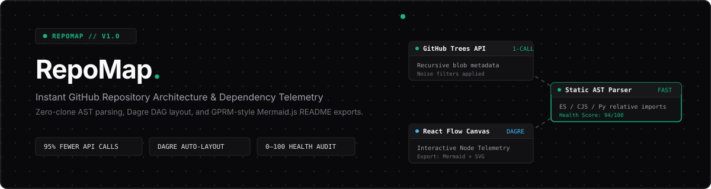
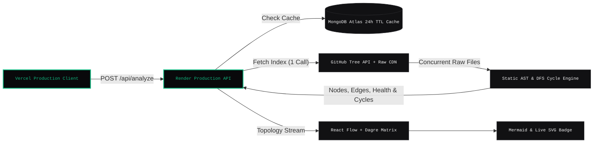

<div align="center">



<br/><br/>

<a href="https://github.com/AtharvDoiphode/Repomap">
  
</a>

<br/>

<!-- Prominent Live Production Action Badges -->
<p align="center">
  <a href="https://repomap-eta.vercel.app">
    
  </a>
  &nbsp;
  <a href="https://repomap-eta.vercel.app/?repo=AtharvDoiphode/Repomap">
    
  </a>
</p>

<p align="center">
  <b>Instant GitHub module dependency visualizer, architecture health audit engine, and native Mermaid.js diagram generator for your project README.</b>
</p>

<!-- Flat Square Stack Badges -->
<p align="center">
  
  
  
  
  
  
  
  
</p>

</div>

---

## ⚡ Key Engineering Highlights

### 1. Single-Call Tree Traversal (95% Fewer API Calls)
Traditional code visualizers make 50+ recursive REST calls, quickly depleting GitHub's 60 req/hr unauthenticated rate limit. RepoMap pulls the full repository tree in a **single call** via `GET /repos/{owner}/{repo}/git/trees/{branch}?recursive=1`, and ingests manifests directly from `raw.githubusercontent.com` concurrently via `Promise.allSettled`.

### 2. DFS Circular Dependency Detector
A built-in Depth-First Search (`DFS`) cycle-detection engine analyzes statically resolved edges using recursion-stack back-edge tracking. Circular import chains (e.g. `a.js → b.js → a.js`) are flagged in the 0–100 architecture health audit, highlighted with amber-dashed lines on the canvas, and listed in the inspection telemetry panel.

### 3. Dynamic Live SVG Architecture Badge Endpoint
Embed a real-time, zero-dependency obsidian badge in any GitHub README using our live production SVG endpoint:
```markdown
[](https://repomap-eta.vercel.app/?repo=<owner>/<repo>)
```
Serves a self-contained, cache-controlled (`max-age=3600`) `196x26` vector badge color-coded by health score:
- **`#10b981` (Emerald)**: Score $\ge 75$
- **`#f59e0b` (Amber)**: Score $50 - 74$
- **`#ef4444` (Rose)**: Score $< 50$

### 4. Interactive Obsidian Canvas & High-Res Export
- **React Flow v12 + Dagre Layout:** Seamlessly switch between Horizontal (`LR`) and Vertical (`TB`) DAG layouts with node selection spotlighting.
- **Viral Export Engine:** 1-click generation of native Mermaid.js flowchart markdown, high-res 2x PNG snapshots (`html-to-image`), raw JSON AST telemetry, and Shields.io badges.

---

## 🛡️ Embed Your Own Live Architecture Badge

Add dynamic architecture health telemetry to your repository README with one line of Markdown:

```markdown
<!-- Replace :owner and :repo with your GitHub repository -->
[](https://repomap-eta.vercel.app/?repo=:owner/:repo)
```

**Live Example (RepoMap):**

[](https://repomap-eta.vercel.app/?repo=AtharvDoiphode/Repomap)

---

## 📊 System Architecture



---

## 🚀 3-Step Local Setup

### 1. Clone & Configure
```bash
git clone https://github.com/AtharvDoiphode/Repomap.git
cd Repomap
cp server/.env.example server/.env
```

### 2. Start Backend
```bash
cd server
npm install
node src/index.js
# Expected: ✅ Connected to MongoDB | 🚀 Server running on http://localhost:5000
```

### 3. Start Frontend Studio
```bash
cd ../client
npm install
npm run dev
# Open http://localhost:5173
```

---

<div align="center">
  <sub>MIT License © 2026 <a href="https://github.com/AtharvDoiphode">Atharv Doiphode</a>. Built for developers and engineering teams.</sub>
</div>
